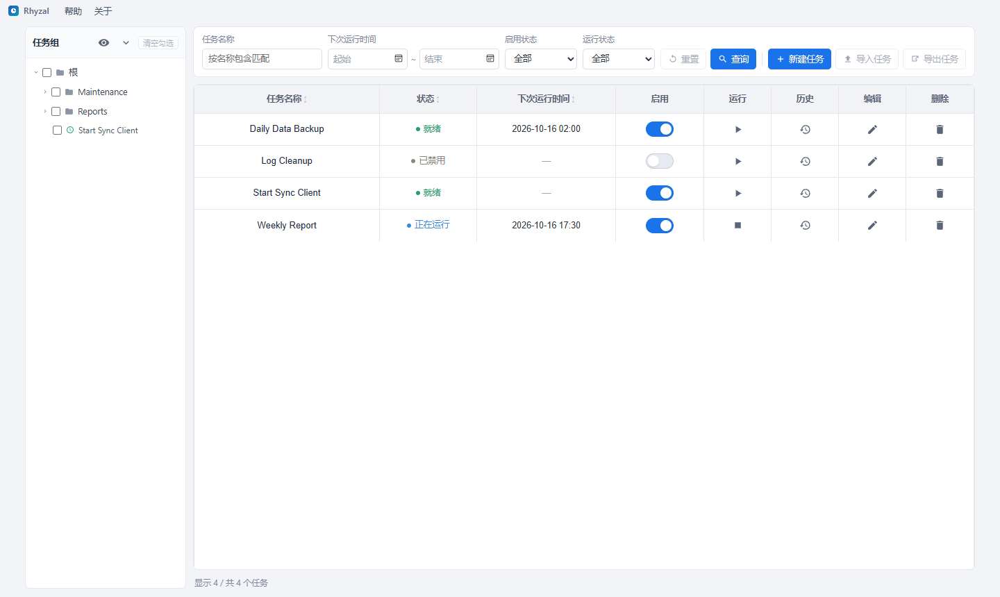
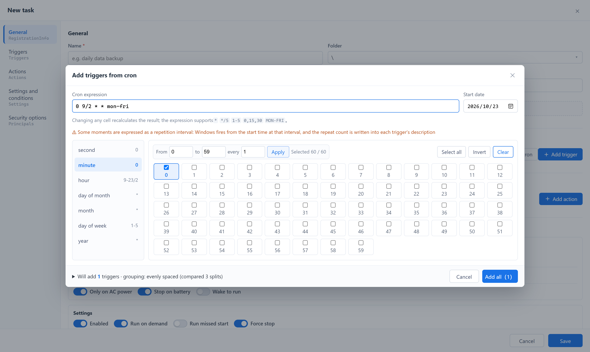

# Tockola

**Schedule Windows tasks the way you already think about schedules.**

Tockola is a free, open-source GUI for the Windows Task Scheduler: cron expressions
in, native Windows triggers out — a friendlier alternative to `taskschd.msc` and
`schtasks.exe` for the tasks you create yourself.

[简体中文](https://github.com/galivea/tockola/blob/master/README.zh-CN.md)

  

  

## Highlights

### Your tasks, not Microsoft's

`taskschd.msc` opens on a few hundred factory tasks and keeps them there. Here the
left tree is both fence and filter:

- **Folder display settings** — tick the folders that are yours and the rest folds
  away for good; the choice survives restarts
- **Multi-select tree** — tick a folder, or one task inside it, and the list shows
  exactly what you ticked
- Name search, next-run window, enabled / Running / recently-failed filters,
  sortable columns — saved as you set them

Everything on the machine is still readable; your own work simply stopped being
the needle.

### Cron in, triggers out

Type `0 9/2 * * mon-fri` and read the Windows triggers *before* saving: how many,
at which times, with what repetition. Moments inside one hour merge into a single
readable chain (7:00 and 7:01 become "daily at 07:00, then every 1 minute, 2
runs"), and cross-hour merging only takes over when it genuinely shortens the
result. A full list of what the generator accepts and refuses is in
[Cron syntax](#cron-syntax) below.

### It asks the engine, never guesses

Next run times come from Windows itself, not from a local calculation: the UI shows
the first five, and refreshes them as you edit a trigger. Run history is read the
same way, with level and category wording in your system locale.

### Nothing gets mangled on the way back

Open a `\Microsoft\` task, a `ComHandler` action, a group principal, an XML element
this app has no control for — it all round-trips verbatim.

### One row away

Enable or disable, run now, stop, rename inline, open the run history, import task
XML, export every task the current query returns as one XML file per task — one
click each, right on the row. The UI follows your Windows display language, with
English as the fallback.

## Cron syntax

### What the generator accepts

Combinations of `*`, `?`, `,`, `-` and `/`, English names such as `MON-FRI` or
`JAN`, the nth-weekday form `6#3`, and the macros `@yearly` `@monthly` `@weekly`
`@daily` `@midnight` `@hourly`.

### What it refuses, and why

| Syntax | Example | Why |
| --- | --- | --- |
| `L` / `LW` / `L-3` | `0 0 L * *` | "Last day of month": Windows monthly triggers take concrete dates only |
| `5L` | `0 0 * * 5L` | "Last weekday of the month": Windows offers 1st–5th, no "last" |
| `W` | `0 0 15W * *` | "Nearest weekday": Windows does not shift weekends for you |
| `H` / `H(0-30)` | `H * * * *` | Jenkins-only hashing, not standard cron |
| `@reboot` | `@reboot` | Startup is not something cron expresses — add an "At startup" trigger instead |
| Timezone prefix | `CRON_TZ=Asia/Shanghai 0 9 * * *` | Windows triggers always run in the machine timezone |
| Leftover command | `0 9 * * * backup.sh` | A whole crontab line was pasted; only the time fields are wanted |
| Sub-minute interval | `* * * * * *` | One minute is the shortest repetition; `*/30 * * * * *` would need 48 separate chains |

### Day-of-month × day-of-week: the trap worth knowing

In standard Unix cron, when day-of-month **and** day-of-week are both restricted
the result is **OR**, not AND:

| Dialect | Both restricted | Note |
| --- | --- | --- |
| Unix/Vixie (crontab, K8s CronJob, GitHub Actions) | **OR** | `0 9 1 * 1` = the 1st **or** every Monday — five or six runs a month |
| Quartz / AWS EventBridge | not allowed | one field must be `?`, which removes the ambiguity |
| Spring `@Scheduled` | **AND** | the opposite of Unix; copying an expression across flips its meaning |

So `0 9 1 * 1` is not "the first Monday", it is "the 1st plus every Monday". The
generator puts an amber warning under the expression box, flags both fields with ⚠,
and tells you an overlapping day runs twice.

The popular "second Tuesday" recipe `0 9 8-14 * 2` hits the same trap: it means
what you want under Quartz or Spring, but under standard cron becomes "the
8th–14th plus every Tuesday". When the generator sees that shape it suggests the
native form `2#2` with the date field left empty.

### If a change does not take

An invalid action flashes a message and rolls back — the box returns to the last
expression that parsed, and ticks go back to what they were. "Some field is still
unset" is a normal intermediate state, never an error: nothing is pre-scheduled
when the editor opens, and the only message at that point is "not set yet: second,
minute, hour".

## Install and updates

Tockola ships as a 64-bit Windows app. All channels serve the same build; pick
whichever fits how you manage software.

| Channel | Install | Update | Good to know |
| --- | --- | --- | --- |
| winget (MSI) | `winget install Galivea.Tockola` | `winget upgrade Galivea.Tockola` | Machine-wide install, clean uninstall, works with group policy |
| Scoop (portable) | `scoop bucket add tockola https://github.com/galivea/scoop-bucket` then `scoop install tockola` | `scoop update tockola` | No elevation; files stay inside your Scoop directory |
| Manual | download from [Releases](https://github.com/galivea/tockola/releases/latest) | **Updates** in the toolbar | The portable zip has no in-app updater |

If `winget install` reports no package found, use Scoop or the Releases page instead.

### Manual downloads

Each release offers three x64 downloads:

| File | Use it when |
| --- | --- |
| `tockola_<ver>_x64-setup.exe` | Everyday install (recommended — handles WebView2 for you) |
| `tockola_<ver>_x64_en-US.msi` | Fleet deployment, group policy, clean uninstall |
| `tockola_<ver>_x64_portable.zip` | Unzip and run, no installer, no elevation |

### Updating

- **MSI / NSIS installs**: press **Updates** in the toolbar; the app downloads the
  new build, installs it and restarts.
- **winget**: `winget upgrade Galivea.Tockola`
- **Scoop**: `scoop update tockola`
- **Portable zip**: no in-app updates. Download the new zip and replace the
  extracted folder. Settings and tasks live outside that folder and survive
  the replacement.

### First launch

Windows may show "Windows protected your PC". Choose **More info → Run anyway**.
On Windows 11 with Smart App Control, unsigned executables can be blocked
outright — use the MSI there.

## Before you start

Reading and writing your own tasks needs no special rights. System tasks — those
under protected folders such as `\Microsoft\` — do: run the app **as
administrator** to reach them, otherwise they come back as a permission error.

## 60 seconds

1. Install and start the app
2. **Display settings** on the left tree → keep only the folders you created
3. **New task** → name + action → **Add from cron** → paste an expression → check
   the preview → **Save**
4. Back in the list: run it once, switch it off, or open its run history

Editing an existing task opens the same page with the same controls.

## License

[MIT](https://github.com/galivea/tockola/blob/master/LICENSE)
