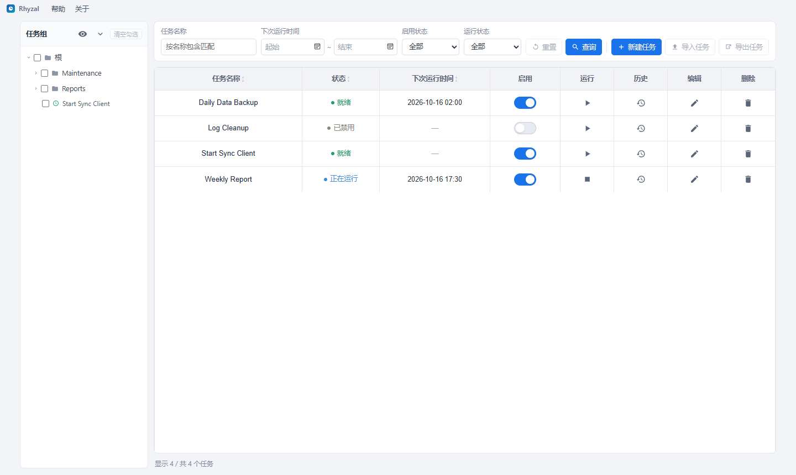
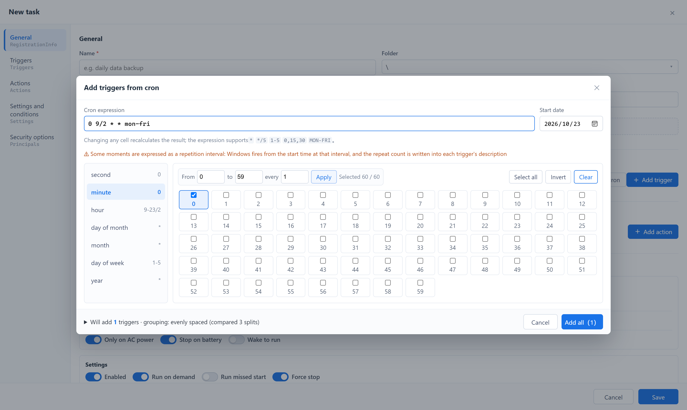

# Tockola

**用你本来就熟悉的方式，管 Windows 的计划任务。**

Tockola 是一个免费开源的 Windows 任务计划程序图形界面：cron 表达式进，Windows 原生触发器出——比 `taskschd.msc` 与 `schtasks.exe` 更顺手，专为你自己创建的任务而生。

[English](https://github.com/galivea/tockola/blob/master/README.md)

  

  

## 亮点

### 只看你自己的任务

`taskschd.msc` 一打开就是几百条出厂任务，而且永远在那儿。这里左侧的任务树既是围栏也是筛选器：

- **任务组显示设置** —— 勾上属于你的那几个组，其余整条分支收起来，这个选择关机重开还在
- **树上的多选** —— 勾一个组就是整组任务，勾单个任务就是那一条，所见即所得
- 名称搜索、下次运行时间区间、启用 / 运行中 / 最近失败筛选、点表头排序，全部自动记住

机器上的任务一个不少照样能看，只是你自己的东西不再是那根针。

### 输入 cron，输出触发器

敲 `0 9/2 * * mon-fri`，保存之前就能读到它会变成哪些 Windows 触发器：几条、几点、重复间隔多少。落在同一个小时里的时刻会合并成一条一眼能看懂的链（7:00 与 7:01 合成「每天 07:00 起，每 1 分钟一次，共 2 次」），只有跨小时方案确实省得多时才让位。生成器接受和拒绝哪些写法，见下面 [cron 语法](#cron-语法)。

### 不去猜，去问引擎

下次运行时间来自 Windows 自己，不是本地算出来的：界面显示前 5 次，改动触发器时随即刷新。运行历史也一样，级别与类别的文字跟着系统语言走。

### 打开再保存，一个字都不丢

系统任务、`ComHandler` 动作、组主体、界面上没有控件的 XML 节点——全都原样带回来。

### 一行之内，全都做得到

启用/禁用、立即运行、停止、行内改名、查看运行历史、导入任务 XML，以及把当前查询到的任务逐个导出成 XML 文件——每一项都是行上一次点击。界面语言跟随 Windows 显示语言，缺省回落到英文。

## cron 语法

### 接受哪些写法

`*`、`?`、`,`、`-`、`/` 的组合，英文名称如 `MON-FRI`、`JAN`，第 N 个星期几的 `6#3`，以及宏 `@yearly` `@monthly` `@weekly` `@daily` `@midnight` `@hourly`。

### 哪些写法转不了，为什么

| 写法 | 例子 | 原因 |
| --- | --- | --- |
| `L` / `LW` / `L-3` | `0 0 L * *` | 「当月最后一天」：Windows 的月触发器只接受具体日期，没有「最后一天」 |
| `5L` | `0 0 * * 5L` | 「当月最后一个星期几」：Windows 只给第 1–5 个，没有「最后」 |
| `W` | `0 0 15W * *` | 「最近的工作日」：Windows 不会替你跳过周末 |
| `H` / `H(0-30)` | `H * * * *` | Jenkins 独有的哈希写法，不属于标准 cron |
| `@reboot` | `@reboot` | 开机是 cron 表达不了的事——请改用「启动时」触发器 |
| 时区前缀 | `CRON_TZ=Asia/Shanghai 0 9 * * *` | Windows 触发器一律按机器时区运行 |
| 多余的命令行 | `0 9 * * * backup.sh` | 粘贴进来的是整行 crontab，这里只要时间字段 |
| 低于一分钟的间隔 | `* * * * * *` | 最短重复间隔是一分钟；`*/30 * * * * *` 要拆成 48 条链才能表达 |

### 日期 × 星期：值得知道的陷阱

标准 Unix cron 里，「日」和「星期」同时被限制时结果是**或**，不是且：

| 方言 | 两者都限制 | 说明 |
| --- | --- | --- |
| Unix/Vixie（crontab、K8s CronJob、GitHub Actions） | **或** | `0 9 1 * 1` = 1 号**或者**每个周一，一个月跑五六次 |
| Quartz / AWS EventBridge | 不允许 | 必须有一个字段写 `?`，从语法上消掉歧义 |
| Spring `@Scheduled` | **且** | 与 Unix 相反，把表达式搬过来意思就翻了 |

所以 `0 9 1 * 1` 不是「一月的第一个周一」，而是「1 号加上每个周一」。生成器会在表达式框下面挂一条琥珀色警告，给两个字段都标上 ⚠，并明说重叠的那天会跑两次。

流传很广的「第二个星期二」写法 `0 9 8-14 * 2` 踩的是同一个坑：在 Quartz / Spring 下它是你要的意思，到标准 cron 里就变成「8–14 号加上每个周二」。生成器看到这个形状时，会建议改用原生写法 `2#2`，日期字段留空。

### 改动没生效时

无效操作会闪一条提示并回滚——表达式框退回上一次能解析的内容，勾选也回到原样。「还有字段没填」是正常中间态，不是错误：打开编辑器时什么都没预设，此时唯一的提示是「尚未设置：秒、分、时」。

## 安装与更新

Tockola 只提供 64 位 Windows 版本。三个渠道用的是同一次构建，按你习惯的软件管理方式选一个即可。

| 渠道 | 安装 | 更新 | 说明 |
| --- | --- | --- | --- |
| winget（MSI） | `winget install Galivea.Tockola` | `winget upgrade Galivea.Tockola` | 整机安装，卸载干净，适合组策略批量部署 |
| Scoop（便携版） | `scoop bucket add tockola https://github.com/galivea/scoop-bucket`，再 `scoop install tockola` | `scoop update tockola` | 不需要提权，文件都在 Scoop 目录里 |
| 手动下载 | 从 [Releases](https://github.com/galivea/tockola/releases/latest) 下载 | 工具栏的**检查更新** | 便携 zip 没有应用内更新 |

如果 `winget install` 提示找不到包，改用 Scoop 或 Releases 页面。

### 手动下载

每个 Release 提供三个 x64 下载文件：

| 文件 | 什么时候用它 |
| --- | --- |
| `tockola_<ver>_x64-setup.exe` | 日常安装（推荐，会顺手处理 WebView2） |
| `tockola_<ver>_x64_en-US.msi` | 批量部署、组策略、干净卸载 |
| `tockola_<ver>_x64_portable.zip` | 解压即用，不用装，不用提权 |

### 怎么更新

- **MSI / NSIS 安装版**：点工具栏的**检查更新**，应用会下载新版本、安装并重启。
- **winget**：`winget upgrade Galivea.Tockola`
- **Scoop**：`scoop update tockola`
- **便携 zip**：没有应用内更新，下载新 zip 后替换解压目录。设置和任务数据不在这个目录里，替换不会丢。

### 首次启动

Windows 可能弹出「Windows 已保护你的电脑」，点**更多信息 → 仍要运行**。开启了 Smart App Control 的 Windows 11 可能直接拒绝未签名的 exe，这种情况请用 MSI。

## 开始之前

读写你自己建的任务不需要任何特殊权限。系统任务——比如 `\Microsoft\` 这类受保护目录下的——需要：**以管理员身份运行**才能碰它们，否则只会拿到一个权限错误。

## 60 秒上手

1. 安装并启动
2. 左侧任务树点**显示设置** → 只保留你自己建的那几个组
3. **新建任务** → 填名称与操作 → **按 cron 添加** → 粘贴表达式 → 确认预览 → **保存**
4. 回到列表：立即跑一次、临时停用、或者翻开它的运行历史

编辑已有任务打开的是同一张页面、同一套控件。

## 许可证

[MIT](https://github.com/galivea/tockola/blob/master/LICENSE)
